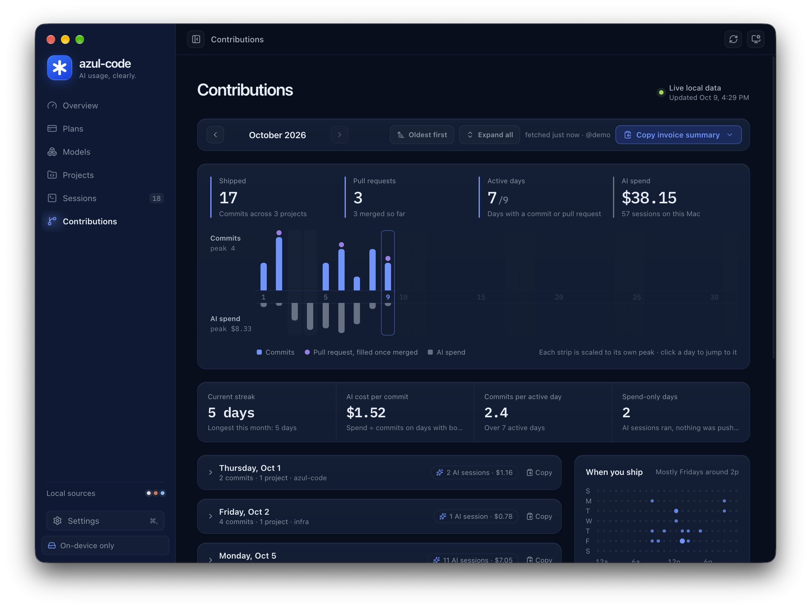

<p align="center">
  
</p>

<h1 align="center">azul-code</h1>
<p align="center"><strong>AI usage, clearly.</strong></p>
<p align="center">A local-first macOS dashboard for AI coding usage, subscription allowances, and GitHub contributions.</p>
<p align="center">
  <a href="LICENSE">MIT</a> ·
  <a href="#install-on-your-mac">Install</a> ·
  <a href="docs/getting-started.md">Getting started</a> ·
  <a href="docs/index.md">Documentation</a> ·
  <a href="CONTRIBUTING.md">Contributing</a>
</p>

See how much you use **Codex, Claude Code, and OpenCode**—across models, projects, and sessions—in one desktop app. Track remaining allowances, understand token costs, and keep a compact summary in your Mac's menu bar.

Local usage analytics need no account or API key. Usage history stays on your Mac. Optional GitHub contributions use your existing GitHub authentication to read the GitHub API. [Privacy details →](docs/privacy.md)


## What you can see

- **Overview & Plans:** remaining subscription allowance, reset times, usage pace, and API-equivalent cost.
- **Models:** token totals, cache efficiency, and estimated cost by model.
- **Projects & Sessions:** workspace breakdowns, a searchable session ledger, and 7-day, 30-day, 90-day, or all-time ranges.
- **Contributions:** monthly GitHub commits and pull requests beside each day's AI spend, your streak, AI cost per commit, when you usually ship, per-project totals, and a copyable invoice summary.
- **Menu bar:** today's usage and remaining allowance without keeping the dashboard open.
- **Settings:** data-source health, system checks, resource diagnostics, model prices kept current from [models.dev](https://models.dev), six accent colors or a custom one, and dark, light, or system appearance.

<details>
<summary><strong>Explore the Models view</strong></summary>


</details>

<details>
<summary><strong>Explore the Contributions view</strong></summary>



</details>

Screenshots use the app's built-in demo data, not a real account. Model availability, allowances, and estimates vary by provider and recorded usage.

## In your menu bar

Keep today's API-equivalent cost, token totals, provider breakdown, and remaining subscription allowance one click away. Refresh usage, open Settings, return to the dashboard, or quit from the companion panel.

<p align="center">
  
</p>

Choose cost, allowance, both, or icon only in **Settings → Menu bar**. Closing the dashboard keeps the companion running; **Quit azul-code** exits the app.

## Install on your Mac

**azul-code is not yet signed or notarized by Apple, so there is no download to install.** macOS blocks unsigned apps downloaded from the internet, often reporting that the app "is damaged and can't be opened." You build azul-code on your own Mac instead: apps you build locally are not marked as downloaded, so macOS opens them normally. It takes a few minutes and needs no Apple account or security setting changes.

### 1. Install the requirements

- **macOS** on Apple Silicon or Intel. The build targets your Mac's own architecture.
- **Git.** Run `git --version`; if it is missing, macOS offers to install the Command Line Tools (or run `xcode-select --install`).
- **Node.js 22**, version 22.12 or newer, which includes npm. Node 22 is the version CI tests; newer releases currently build azul-code too, but npm prints an `EBADENGINE` warning and they are not tested. Install Node 22 with one of:
  - [nvm](https://github.com/nvm-sh/nvm): after cloning in step 2, run `nvm install` in that folder; it reads the included [`.nvmrc`](.nvmrc).
  - [Homebrew](https://brew.sh): `brew install node@22`, then follow its instructions to add it to your `PATH`.
  - The macOS installer for the latest Node 22 release from [nodejs.org](https://nodejs.org/en/download).

Check with `node --version`; it should print `v22.x.x`. Node is only needed to build azul-code; the installed app does not use it.

### 2. Build and install

```bash
git clone https://github.com/l-velazquez/ai-codeing-stats.git
cd ai-codeing-stats
npm ci
npm run dist:mac
open release/azul-code-*.dmg
```

Drag **azul-code** into **Applications**, then open it from Applications or Spotlight. The repository is named `ai-codeing-stats`; the app is **azul-code**.

### Update

Quit azul-code (**Quit azul-code** in the menu bar panel), then from the cloned folder:

```bash
git pull
npm ci
npm run dist:mac
open "$(ls -t release/*.dmg | head -1)"
```

The last line opens the newest DMG, since `release/` keeps older builds. Replace the app in Applications. Your settings live in `~/Library/Application Support/azul-code/` and carry over.

### What's next for installation

Signed, notarized downloads are planned: azul-code will be signed with an Apple Developer ID and notarized by Apple, then published as a DMG on GitHub Releases that opens like any other Mac app. Until then, build it yourself as above. A DMG built on another Mac and then downloaded or AirDropped to yours is blocked for the same reason; please don't work around that by disabling Gatekeeper.

## Run in development

To work on azul-code itself, run it straight from the source:

```bash
npm ci
npm run dev
```

For a browser preview with generated data:

```bash
npm run dev:web
```

Open `http://localhost:4317`. See [preview states](docs/development.md#browser-preview) for empty, waiting, and error scenarios.

## Connect your tools

| Tool | Local usage source | Allowance support |
| --- | --- | --- |
| Codex | `~/.codex/sessions/**/*.jsonl` | Recorded short-window and weekly limits |
| Claude Code | `~/.claude/projects/**/*.jsonl` | Automatic from T3 Code's default local Claude cache; otherwise choose **Connect Claude Code**, then send a message in terminal Claude Code |
| OpenCode | `~/.local/share/opencode/opencode.db` | Usage totals only; requires `sqlite3` |

Claude allowance setup installs a local status-line wrapper and updates `~/.claude/settings.json`, preserving an existing command. Review [connection behavior and removal](docs/privacy.md#claude-connection-behavior).

For **Contributions**, install [GitHub CLI](https://cli.github.com/) and run `gh auth login`. You can also launch the app with `GITHUB_TOKEN` or `GH_TOKEN` in its environment. GitHub is optional; see [setup and coverage](docs/getting-started.md#connect-github).

## About the dollar amounts

**API-equivalent cost is an estimate, not your subscription bill.** It represents recorded token usage at public API list prices, kept current from [models.dev](https://models.dev) (you can turn this off in Settings to use only the bundled prices). Unknown models stay visible and are marked as partially priced. Cache handling and provider reporting can affect totals; see [data and calculations](docs/data-and-calculations.md).

The scanner reads local transcript files to extract metadata. Prompt text and tool output are not included in the dashboard data model. [Privacy and local storage](docs/privacy.md) explains the underlying reads, temporary files, and optional network access.

## Build and verify

```bash
npm test
npm run build
```

The build runs TypeScript checks and verifies the preload bundle and required assets. GitHub Actions runs tests and the production build on macOS; Dependabot checks dependency updates.

`npm run dist:mac` writes DMG and ZIP packages to `release/` for the build machine's architecture. **Packaging does not sign or notarize them**, so they are for installing on the Mac that built them, not for sharing. See the [public release checklist](docs/releasing.md) for the signing plan. There is no automatic-update service yet; updating means rebuilding (see [Update](#update)).

## Documentation

| Guide | Contents |
| --- | --- |
| [Getting started](docs/getting-started.md) | Setup, first data, and GitHub connection |
| [User guide](docs/user-guide.md) | Pages, menu bar, appearance, and everyday workflows |
| [Data and calculations](docs/data-and-calculations.md) | Token accounting, pricing, and source limitations |
| [Privacy](docs/privacy.md) | Local storage, credentials, and removal |
| [Development](docs/development.md) | Commands, previews, native smoke checks, and icons |
| [Architecture](docs/architecture.md) | Processes, IPC, and data flow |
| [Troubleshooting](docs/troubleshooting.md) | Missing data and launch issues |

## Contributing and security

Bug reports and focused pull requests are welcome. Start with [CONTRIBUTING.md](CONTRIBUTING.md), use synthetic fixtures, and remove personal paths and account details from screenshots or logs. Report vulnerabilities through the private route in [SECURITY.md](SECURITY.md).

## License and credits

Copyright 2026 Luis Velazquez and azul-code contributors. Released under the [MIT License](LICENSE). See [third-party notices](THIRD_PARTY_NOTICES.md) for included material and its separate terms.

Inspired by the information density and local-first approach of [T3 Code](https://github.com/pingdotgg/t3code). azul-code is an independent project; provider names and logos identify supported tools and do not imply endorsement.
