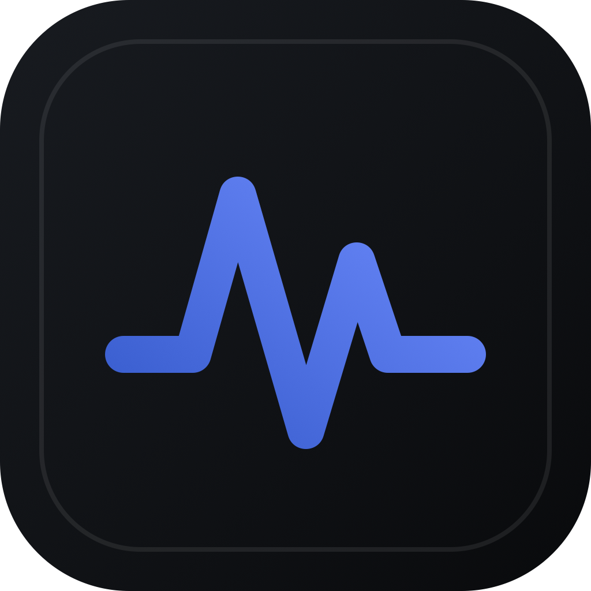
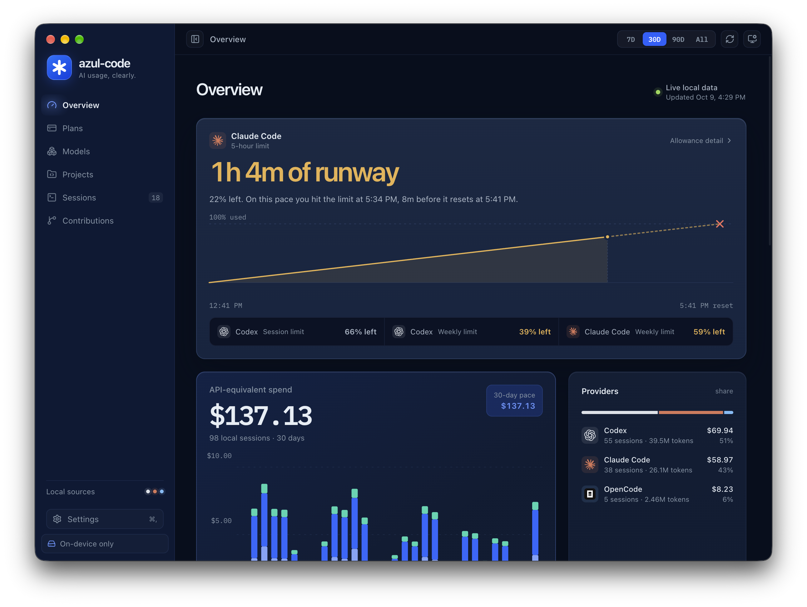
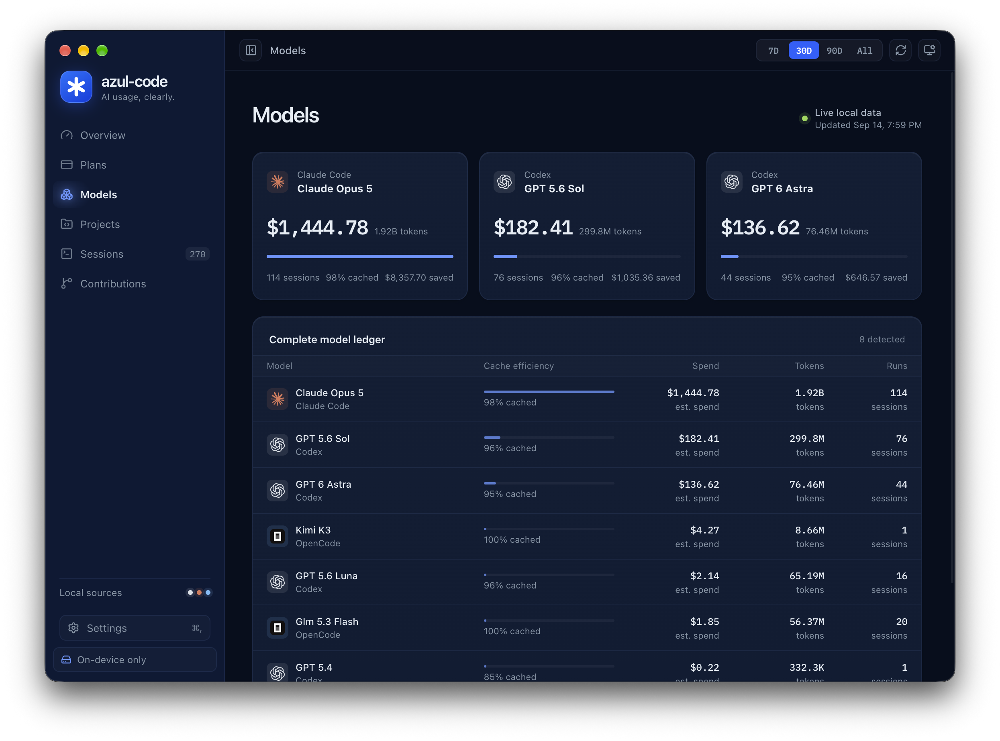
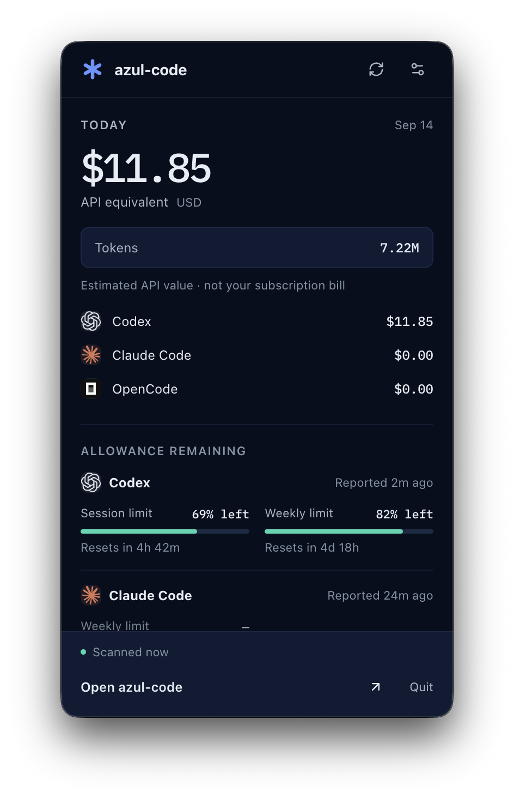

<p align="center">
  
</p>

<h1 align="center">azul-code</h1>
<p align="center"><strong>AI usage, clearly.</strong></p>
<p align="center">A local-first macOS dashboard for AI coding usage, subscription allowances, and GitHub contributions.</p>
<p align="center">
  <a href="LICENSE">MIT</a> ·
  <a href="docs/getting-started.md">Getting started</a> ·
  <a href="docs/index.md">Documentation</a> ·
  <a href="CONTRIBUTING.md">Contributing</a>
</p>

See how much you use **Codex, Claude Code, and OpenCode**—across models, projects, and sessions—in one desktop app. Track remaining allowances, understand token costs, and keep a compact summary in your Mac's menu bar.

Local usage analytics need no account or API key. Usage history stays on your Mac. Optional GitHub contributions use your existing GitHub authentication to read the GitHub API. [Privacy details →](docs/privacy.md)



## What you can see

- **Overview & Plans:** remaining subscription allowance, reset times, usage pace, and API-equivalent cost.
- **Models:** token totals, cache efficiency, and estimated cost by model.
- **Projects & Sessions:** workspace breakdowns, a searchable session ledger, and 7-day, 30-day, 90-day, or all-time ranges.
- **Contributions:** monthly GitHub commits and pull requests, a daily heat grid, project totals, and a copyable invoice summary.
- **Menu bar:** today's usage and remaining allowance without keeping the dashboard open.
- **Settings:** data-source health, system checks, resource diagnostics, six accent colors, and dark, light, or system appearance.

<details>
<summary><strong>Explore the Models view</strong></summary>



</details>

Screenshots show one local installation. Model availability, allowances, and estimates vary by provider and recorded usage.

## In your menu bar

Keep today's API-equivalent cost, token totals, provider breakdown, and remaining subscription allowance one click away. Refresh usage, open Settings, return to the dashboard, or quit from the companion panel.

<p align="center">
  
</p>

Choose cost, allowance, both, or icon only in **Settings → Menu bar**. Closing the dashboard keeps the companion running; **Quit azul-code** exits the app.

## Get started

**Requirements:** macOS, Node.js 22.12 or newer within Node 22, and npm. An [`.nvmrc`](.nvmrc) is included for Node version managers. Agent tools are optional; real analytics appear when supported local usage files exist.

```bash
git clone https://github.com/l-velazquez/ai-codeing-stats.git
cd ai-codeing-stats
npm ci
npm run dev
```

The repository name is currently `ai-codeing-stats`; the app is named **azul-code**.

For a browser preview with generated data:

```bash
npm run dev:web
```

Open `http://localhost:4317`. See [preview states](docs/development.md#browser-preview) for empty, waiting, and error scenarios.

### Connect your tools

| Tool | Local usage source | Allowance support |
| --- | --- | --- |
| Codex | `~/.codex/sessions/**/*.jsonl` | Recorded short-window and weekly limits |
| Claude Code | `~/.claude/projects/**/*.jsonl` | Choose **Connect Claude Code**, then send a message in Claude Code |
| OpenCode | `~/.local/share/opencode/opencode.db` | Usage totals only; requires `sqlite3` |

Claude allowance setup installs a local status-line wrapper and updates `~/.claude/settings.json`, preserving an existing command. Review [connection behavior and removal](docs/privacy.md#claude-connection-behavior).

For **Contributions**, install [GitHub CLI](https://cli.github.com/) and run `gh auth login`. You can also launch the app with `GITHUB_TOKEN` or `GH_TOKEN` in its environment. GitHub is optional; see [setup and coverage](docs/getting-started.md#connect-github).

### About the dollar amounts

**API-equivalent cost is an estimate, not your subscription bill.** It represents recorded token usage at the app's bundled API rates. Unknown models stay visible and are marked as partially priced. Cache handling and provider reporting can affect totals; see [data and calculations](docs/data-and-calculations.md).

The scanner reads local transcript files to extract metadata. Prompt text and tool output are not included in the dashboard data model. [Privacy and local storage](docs/privacy.md) explains the underlying reads, temporary files, and optional network access.

## Build and verify

```bash
npm test
npm run build
```

The build runs TypeScript checks and verifies the preload bundle and required assets. GitHub Actions runs tests and the production build on macOS; Dependabot checks dependency updates.

Create a local macOS package:

```bash
npm run dist:mac
```

DMG and ZIP artifacts are written to `release/` for the build machine's architecture. **Packaging alone does not sign or notarize a release.** See the [public release checklist](docs/releasing.md) before distributing installers. There is no configured automatic-update service.

## Documentation

| Guide | Contents |
| --- | --- |
| [Getting started](docs/getting-started.md) | Setup, first data, and GitHub connection |
| [User guide](docs/user-guide.md) | Pages, menu bar, appearance, and everyday workflows |
| [Data and calculations](docs/data-and-calculations.md) | Token accounting, pricing, and source limitations |
| [Privacy](docs/privacy.md) | Local storage, credentials, and removal |
| [Development](docs/development.md) | Commands, previews, native smoke checks, and icons |
| [Architecture](docs/architecture.md) | Processes, IPC, and data flow |
| [Troubleshooting](docs/troubleshooting.md) | Missing data and launch issues |

## Contributing and security

Bug reports and focused pull requests are welcome. Start with [CONTRIBUTING.md](CONTRIBUTING.md), use synthetic fixtures, and remove personal paths and account details from screenshots or logs. Report vulnerabilities through the private route in [SECURITY.md](SECURITY.md).

## License and credits

Copyright 2026 Luis Velazquez and azul-code contributors. Released under the [MIT License](LICENSE). See [third-party notices](THIRD_PARTY_NOTICES.md) for included material and its separate terms.

Inspired by the information density and local-first approach of [T3 Code](https://github.com/pingdotgg/t3code). azul-code is an independent project; provider names and logos identify supported tools and do not imply endorsement.
