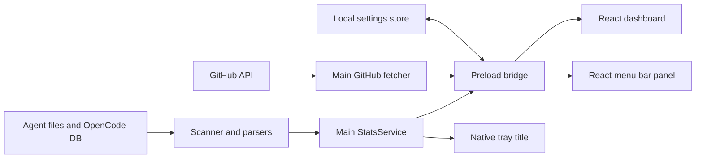

# Architecture

[Documentation index](index.md)

## Process boundaries

azul-code uses Electron, React, TypeScript, and electron-vite. The main process owns filesystem access, subprocesses, GitHub requests, native windows, preferences, and the tray. The renderer presents typed snapshots. A sandboxed CommonJS preload exposes a narrow `window.azulCode` bridge.

## Source map

| Location | Responsibility |
| --- | --- |
| `src/main/index.ts` | App lifecycle, IPC handlers, dashboard window, shared service wiring |
| `src/main/transcripts.ts` | Codex and Claude line parsing and normalized usage records |
| `src/main/scanner.ts` | Source discovery, OpenCode query, allowance reads, aggregation, record cache |
| `src/main/statsService.ts` | Shared refresh scheduling, request coalescing, state/error broadcasts |
| `src/main/menuBar.ts` | Native tray, panel placement/window, quick actions, theme updates |
| `src/main/claudeStatusLine.ts` | Claude wrapper installation and capture parsing |
| `src/main/github.ts` | Credential discovery, API reads, month aggregation/cache |
| `src/main/systemChecks.ts` | Tool discovery and setup status |
| `src/main/settingsStore.ts` | Atomic preference persistence and usable window bounds |
| `src/preload/index.ts` | Typed IPC facade and event subscription cleanup |
| `src/shared/` | Contracts, settings normalization, token/pricing math, projection, invoice text, menu bar formatting |
| `src/renderer/src/app/routes.ts` | Page IDs, labels, navigation, range support |
| `src/renderer/src/pages/` | Six dashboard pages |
| `src/renderer/src/components/` | Shell, settings, allowance, data, GitHub, and primitive UI |
| `src/renderer/src/hooks/` | Snapshot/month loading, theme, sidebar, clipboard, refresh helpers |
| `src/renderer/src/styles/` | Theme tokens and component/page CSS |
| `src/renderer/src/MenuBarApp.tsx` | Compact menu bar renderer |

## Refresh and data flow

`StatsService` is the refresh owner for all windows. Startup invalidates the scanner cache and scans sources. Concurrent refresh requests share a promise. The service builds the menu bar summary from records since local midnight and publishes change notifications. Dashboard range reads reuse cached normalized records and aggregate them on demand.

A `SourceWatcher` watches the directories every source writes to -- both transcript trees recursively, plus the Claude status-line capture directory and the OpenCode database directory, where the `-wal` file is the signal. Events are throttled, not debounced on a resetting timer: the first event after a quiet spell schedules a scan about a second out, events until then ride along with it, anything arriving mid-scan earns exactly one more, and two scans are never closer than two seconds. A provider with no directory is skipped, and the watcher reports how many targets it took.

The service schedules its next scan after completion, within its poll interval or at the next local midnight. That interval is five seconds when nothing is watched and fifteen when the watcher is running, because the poll is then only a safety net: a missed event, a provider installed after launch, and the midnight rollover. Suspend stops the timer; resume starts it again. Closing the dashboard does not stop the service on macOS. The scanner also has a two-second cache for direct callers, but service refresh explicitly invalidates it.

Scans are incremental. The scanner keeps per-file parse results keyed by size and mtime; an unchanged transcript is reused, and a transcript that only grew is read from the byte offset of its last complete line, so a half-written line is deferred rather than lost. A pass that finds nothing new costs one `stat` per transcript instead of a re-parse of every byte, which is what allows the short interval. `statsRevision()` moves only when a pass finds different usage, and background ticks are silent: they publish a fresh scan time to the menu bar but raise no spinner and notify renderers to re-aggregate only on a real change. `resetStatsCache()` forgets every file and exists for tests.

On failure, the service retains its previous menu bar summary and exposes an error. Renderer snapshot loading retains an existing dashboard on refresh failure and uses a retry state when the first load fails. Request IDs prevent older responses replacing a newer range/month selection.

GitHub uses a separate ten-minute in-memory month cache and renderer month cursor. `useGithubMonth` lives above page transitions, preserving the selected month during navigation. The daily AI cost index reads All history so older contribution months do not depend on the dashboard range.

## Bridge contract

[`AzulCodeBridge`](../src/shared/types.ts) is the authoritative interface exposed as `window.azulCode`.

| Bridge group | Operations |
| --- | --- |
| Usage | `scan(range, refresh?)`, `subscriptions()`, `onStatsChanged()` |
| Claude setup | `setupClaudeStatusLine()` |
| GitHub/system | `github(month, refresh?)`, `systemChecks()` |
| Preferences | `settings.get()`, `settings.set(patch)`, `onSettingsChanged()` |
| Native actions | `openPath()`, `openUrl()`, `onOpenSettings()` |
| Menu bar | `get`, `refresh`, `onChange`, `openDashboard`, `hide`, `quit`, `setHeight(height)` |
| Startup state | `initial` theme/accent/sidebar values, `platform` |

The preload exposes specific methods, not arbitrary IPC channels or Electron event objects. Subscriptions return cleanup functions. Main handlers validate usage ranges and month input; external URLs are restricted to HTTP(S). Native path opening delegates to Electron's shell.

Windows use sandboxing, context isolation, and disabled Node integration. Main points to `out/preload/index.cjs`; keeping the preload CommonJS is required for this sandboxed loader. `verify:build` checks the compiled preload reference and tray resources.

## State and lifecycle

Settings normalize unknown/corrupt values into defaults. Main reads them synchronously before creating windows, passes initial theme/sidebar state through preload arguments, and broadcasts later changes across windows. Window bounds are saved after move/resize and on close; off-display positions are discarded when restoring.

The app requests a single-instance lock. A second launch opens the dashboard. The macOS Dock activation event also reopens it. Quit stops the service and destroys the tray. The display name, app-data directory, bridge, IPC namespace, and packaging identity all use azul-code.

The settings schema still contains `range` and `subscriptionPollSeconds`; the current dashboard starts at 30d and the refresh service uses a fixed five-second schedule. Do not assume every persisted field is a live user control.

## Settings reference

The version-1 schema in [`settings.ts`](../src/shared/settings.ts) normalizes each field independently.

| Field | Default | Accepted values / behavior |
| --- | --- | --- |
| `theme` | `system` | `dark`, `light`, `system` |
| `accent` | `blue` | `red`, `orange`, `green`, `blue`, `pink`, `violet`, or `custom` |
| `customAccent` | `#00c8ff` | Hex colour (`#rgb` or `#rrggbb`); used when `accent` is `custom` and re-derived into readable roles per theme |
| `range` | `30d` | `7d`, `30d`, `90d`, `all`; currently not restored by App |
| `subscriptionPollSeconds` | `15` | Positive values rounded and clamped to 5–300; not used by the current service schedule |
| `window` | `null` | Positive width/height, optional finite x/y coordinates |
| `sidebarCollapsed` | `false` | Boolean |
| `menuBarEnabled` | `true` | Boolean |
| `menuBarDisplay` | `cost` | `cost`, `allowance`, `both`, `icon` |
| `menuBarProvider` | `codex` | `codex`, `claude` |
| `menuBarWindow` | `session` | `session`, `weekly` |
